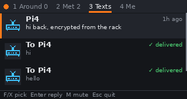

# Nearby for CardputerZero

Swap profile cards with every CardputerZero you pass, and send end-to-end encrypted texts to the
people you meet.

<p>
  
  
</p>

- **Your card:** a nickname, a colour, a status line and a 16x16 avatar you draw on the keyboard.
- **Pass-by:** walk past anyone else running Nearby and you swap cards automatically.
- **Around** shows who is in range right now. **Met** is everyone you have ever swapped with.
- **Texts:** send up to 40 characters to anyone you have met. Only they can read it, a tick shows
  when it arrived, and a text for you pops up and beeps. Mute anyone who spams.
- **Safety code:** each chat shows 6 digits that are the same on both devices. Compare them in
  person once to be sure nobody faked a card. A copied card is flagged and texting it is blocked.
- **Listen-only** hides you completely. **Background off** saves about 25 MB of memory: Nearby then
  only runs while the app is open.

Cards are public, and people nearby can see who you text and when (not what).

## Install

On the CardputerZero (Raspberry Pi OS based), in one command:

```sh
git clone https://github.com/subnetsmith/cardputer-nearby && cd cardputer-nearby && sh packaging/build-deb.sh && sudo apt install ./build/nearby_*_all.deb
```

**Nearby** appears in the launcher, the service starts straight away and at every boot, and the
app starts it on demand. Remove it with `sudo apt remove nearby`.

## Keys

| Key | Does |
| --- | --- |
| 1 2 3 4 | Around, Met, Texts, Me |
| F / X | up / down |
| Z / C | left / right (colour, avatar cursor) |
| Enter | text the highlighted person, reply in Texts, or edit a row on Me |
| Space | paint or erase a pixel in the avatar editor (Backspace clears it) |
| M | mute or unmute the highlighted person |
| Esc | leave an editor (your card saves; an unsent text asks first) or quit |

F/X/Z/C are the same arrows the CardputerZero launcher uses.

## How it works

- **`nearbyd`**, a systemd service, owns the Bluetooth chip. It talks to it over a raw HCI socket:
  random address, advertising, passive scan. It runs as your user with one extra capability,
  `CAP_NET_RAW`, and `NoNewPrivileges`. Not root.
- **`nearbyd.socket`** (`/run/nearby.sock`, owner-only) lets systemd start the service when the
  app connects, so Background off costs nothing while the app is closed.
- **`nearby`**, the app, draws the 320x170 screen straight to the framebuffer with Pillow, reads
  the keyboard from evdev, and only redraws when something changes (about 0.3% CPU idle).

**The beacon.** A card doesn't fit in one 31-byte advert, so it goes out in pieces, one every half
second: card (nickname + colour), status, avatar halves, public key halves, plus any text or
receipt being sent. Each piece is one manufacturer-data field:

```
FF FF | B7 | version<<4 | kind | card id (3 bytes) | payload (up to 22 bytes)
```

0xFFFF is the company id the Bluetooth SIG reserves for testing, so it belongs to no company.

**Encryption.** Every card carries an X25519 public key. Two people's keys give a shared key
(through HKDF-SHA256); a text is sealed with ChaCha20-Poly1305, all from the `cryptography`
package, nothing hand-rolled. The nonce is sender id, recipient id and the sender's text counter,
which is written to disk (fsync) before the text goes on air, so it never repeats. A 40-character
text plus its 16-byte tag goes out as 4 fragments, resent for up to 2 minutes until the receiver
sends back a receipt signed with the same shared key (HMAC-SHA256), so a receipt can't be faked.
Altered texts fail the tag check; replays are ignored by the counter; the first key seen for a
card is pinned and a different one marks the card as copied. The private key stays in
`~/.local/share/nearby/profile.json` (0600) and is never sent to the app.

Limits: who texts whom is visible; cards themselves aren't signed (a copier can show a card's
name, but can't read or fake texts, and is flagged once it sends its own key); there is no
forward secrecy, so someone who later copies your key file could read texts they recorded.

**Real radios are lossy.** On a CardputerZero, beacons go missing for seconds at a time (Wi-Fi
shares the radio). A nickname arrives within a second or two, a full card and key in up to a
minute, a text usually in 10-40 s. Someone drops off Around after 30 s unheard. Another app
driving the radio directly can switch Nearby's scanning off; `nearbyd` restarts the radio after
20 s of silence.

## Command line

```sh
nearbyd status                    # your card, who is around, who you met (with safety codes), texts
nearbyd card --nick Ada --colour 2 --status "ask me about Rust"
nearbyd text Ada "come say hi"
nearbyd listen on                 # listen-only
nearbyd background off            # only run while the app is open
```

## Tests

```sh
python3 -m unittest -v
```

Packets, the HCI command loop, card and key swapping between simulated devices, encryption
(altered, replayed and forged texts, copied cards, fake receipts, fragment floods), file
permissions, the socket, every screen and every key path in the app.

## Limits

- The service assumes your user is uid 1000, the first account on CardputerZero images.
- Shifted symbols follow a US layout.
- Bluetooth 4.2 legacy advertising only. Version 1.2 can't talk to 1.1 (the beacon format changed).

MIT licence.
