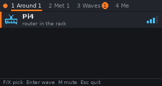

# Nearby for CardputerZero

Swap profile cards with every CardputerZero you pass, and wave at the ones around you.

<p>
  
  
</p>

- **Your card:** a nickname, a colour, a status line and a 16x16 avatar you draw on the keyboard.
- **Pass-by:** walk past anyone else running Nearby and you swap cards automatically, even with
  the app closed and the Cardputer in your pocket.
- **Around** shows who is in range right now. **Met** is everyone you have ever swapped with.
- **Waves:** pick someone and send a short message (18 characters). Their Cardputer beeps and
  pops it up. Mute anyone who spams.

Everything is sent in the open over Bluetooth LE: anyone nearby running Nearby can read your card
and your waves. Turn on **listen-only** to see others without being seen.

## Install

On the CardputerZero (Raspberry Pi OS based), in one command:

```sh
git clone https://github.com/subnetsmith/cardputer-nearby && cd cardputer-nearby && sh packaging/build-deb.sh && sudo apt install ./build/nearby_*_all.deb
```

**Nearby** appears in the launcher and the background service starts straight away and at every
boot. Remove it with `sudo apt remove nearby`.

## Keys

| Key | Does |
| --- | --- |
| 1 2 3 4 | Around, Met, Waves, Me |
| F / X | up / down |
| Z / C | left / right (colour, avatar cursor) |
| Enter | wave at the highlighted person, or edit a row on Me |
| Space | paint or erase a pixel in the avatar editor (Backspace clears it) |
| M | mute or unmute the highlighted person |
| Esc | leave an editor (your card saves) or quit |

F/X/Z/C are the same arrows the CardputerZero launcher uses.

## How it works

Two programs, both Python 3 standard library plus Pillow and numpy:

- **`nearbyd`**, a systemd service, owns the Bluetooth chip. It talks to it over a raw HCI socket:
  it sets a random address, advertises your card and runs a passive scan. It runs as your user
  with one extra capability, `CAP_NET_RAW`, and `NoNewPrivileges`. Not root.
- **`nearby`**, the app, draws the 320x170 screen straight to the framebuffer with Pillow, reads
  the keyboard from evdev, and asks `nearbyd` for data over a Unix socket that only your user can
  open.

**The beacon.** A card doesn't fit in one 31-byte advert, so it goes out in pieces, one every half
second: card (nickname + colour), status, avatar top half, avatar bottom half, and any wave you are
sending. Each piece is one manufacturer-data field:

```
FF FF | B7 | version<<4 | kind | card id (3 bytes) | payload (up to 22 bytes)
```

0xFFFF is the company id the Bluetooth SIG reserves for testing, so it belongs to no company. A
revision byte in each piece stops an old status or avatar being mixed with a new card.

**Privacy.** The radio address is a non-resolvable private address that changes every 15 minutes.
Your card, though, is a name badge: anyone who sees it again can recognise it. Listen-only stops
sending entirely. Text from other people is cut to printable ASCII before it is stored or drawn.

**Real radios are lossy.** On a CardputerZero, beacons go missing for seconds at a time (Wi-Fi
shares the radio). A nickname arrives within a second or two; a full avatar can take 20-30 s.
Someone drops off Around after 30 s unheard. Another app driving the radio directly can switch
Nearby's scanning off; `nearbyd` notices the silence and restarts the radio within 20 s.

Data lives in `~/.local/share/nearby/` (your card, everyone you met, your waves), written
atomically.

## Command line

```sh
nearbyd status                    # your card, who is around, who you met, recent waves
nearbyd card --nick Ada --colour 2 --status "ask me about Rust"
nearbyd wave Ada "come say hi"
nearbyd listen on                 # listen-only
```

## Tests

```sh
python3 -m unittest -v
```

Packets and parsing, the HCI command loop, card swapping between two simulated devices, waves,
mute, listen-only, saving, the socket, every screen, and every key path in the app.

## Limits

- The service assumes your user is uid 1000, the first account on CardputerZero images.
- Shifted symbols follow a US layout.
- Bluetooth 4.2 legacy advertising only (no extended adverts on this chip).

MIT licence.
